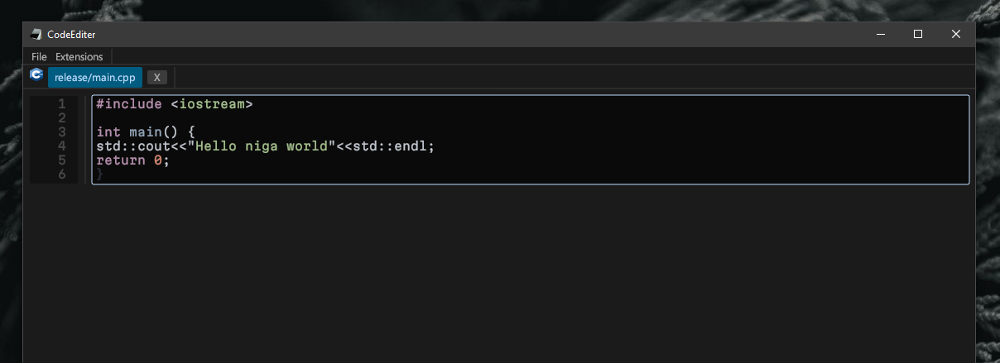

CodeEditer is an open source lightweight code editor for Windows.

## ✨ Features

* ⚙️ Lightweight - uses fewer resources than VS code it self.
* 🧩 Extensions - Customize your experience.
* 🛠️ - Simple UI without any clutter.

## 📜 License

This project is licensed under the **GPL-3.0 License**. Check the `LICENSE` file for more information.

# 🖥️ Requirements

OS: ``Windows Vista or Newer``

.NET Framework: ``4.5.2 or newer``

## 📊 Compatibility table

| Operating System | Compatibility | Notes |
|---|---|---|
| Windows XP SP3 | ❓ Not Tested | .NET Framework 4.5.2 and One Core API|
| Windows Vista | ❓ Not Tested yet | .NET Framework 4.5.2 is last supported yet |
| Windows 7 | ✅ Supported | Everything works|
| Windows 8 / 8.1 | ✅ Supported | - |
| Windows 10 | ✅ Supported | - |
| Windows 11 | ✅ Supported | - |
| Linux | ⚠️ Experimental | Can run through Wine, but is not officially supported |
